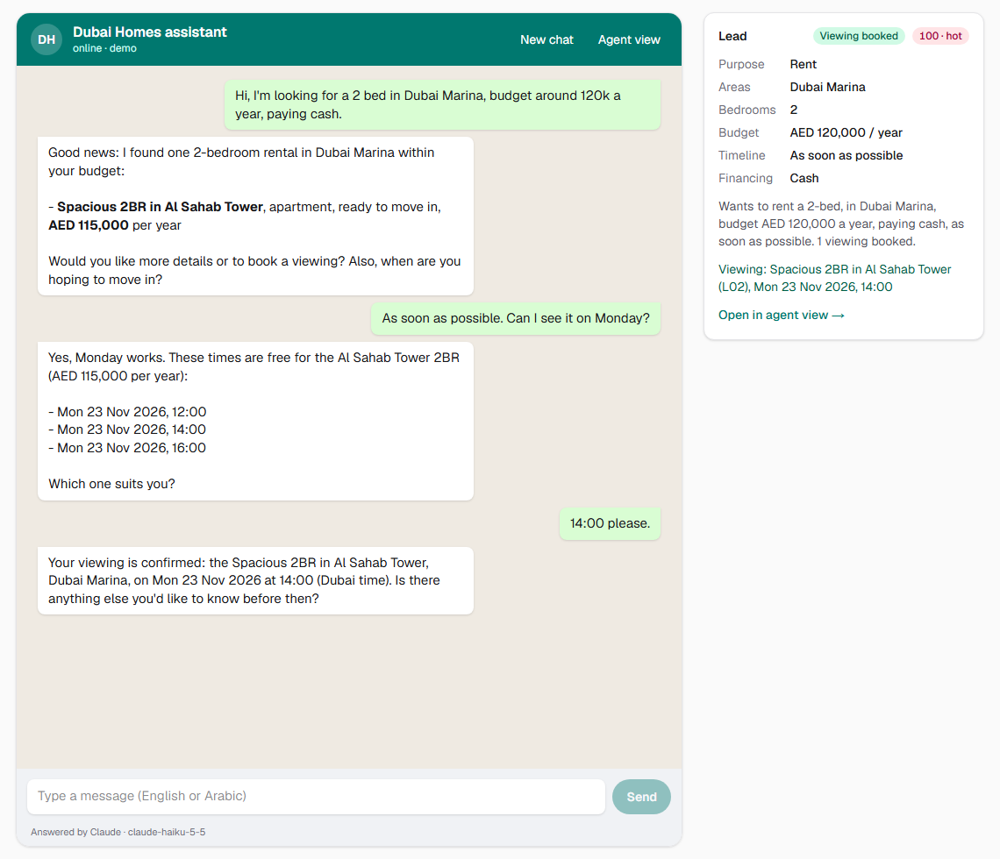
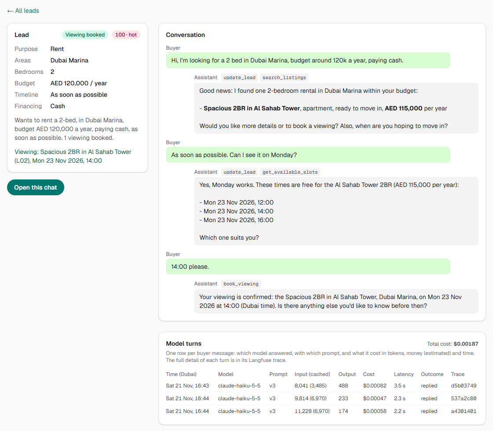
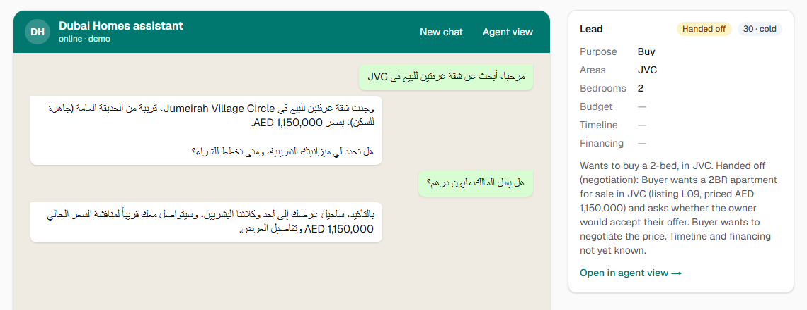
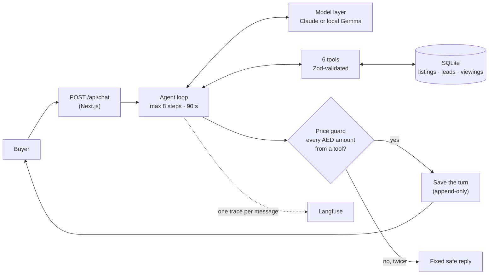
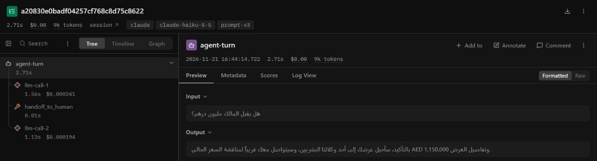

# Dubai Lead Agent

An AI agent that qualifies real estate leads for a fictional Dubai agency. It chats with buyers in English or
Arabic, saves what they need (budget, area, bedrooms, timeline, cash or mortgage), searches listings, books
viewings and hands off to a human when it should (negotiation, complaints, or when asked).

Built to be **measured, not just demoed**: 33 golden conversations, code checks on the end state, a calibrated LLM
judge, tracing, and versioned prompts. Every number below comes from [`evals/runs/`](evals/runs/COMPARISON.md).



<table>
  <tr>
    <td></td>
    <td></td>
  </tr>
  <tr>
    <td><b>Agent view:</b> fields, score, viewing, the tools behind each reply, tokens and cost per turn.</td>
    <td><b>Arabic:</b> an offer ("would the owner take a million?") goes to a human, with the real price.</td>
  </tr>
</table>

## Results

Claude Haiku 5.5 with the current prompt (v3), 33 cases × 3 runs, graded on 2026-11-21:

| Pass (code checks + judge) | Code checks | Price questions | Language | Cost per conversation | Time per reply |
| -------------------------- | ----------- | --------------- | -------- | --------------------- | -------------- |
| **95/99** (96%)            | **100%**    | 12/12           | 100%     | $0.0005               | 2.4 s          |

**Model comparison** (same graders; Gemma and the do-nothing agent ran on the first 31 cases, once each):

| Agent                                      | Pass    | Code checks | Tool use | Handoff | Time per reply |
| ------------------------------------------ | ------- | ----------- | -------- | ------- | -------------- |
| Claude Haiku 5.5, prompt v3                | **96%** | **100%**    | 100%     | 100%    | 2.4 s          |
| Gemma 3 4B, local in LM Studio (prompt v1) | 0%      | 23%         | 41%      | 61%     | 20.1 s         |
| Do-nothing agent ("Hello! How can I help") | 0%      | 29%         | 24%      | 84%     | —              |

Gemma misuses tools (bookings with no arguments, wrong date formats), which a prompt change is unlikely to fix, so
it is used for free local development only. The do-nothing agent is the sanity check:
a case set that a do-nothing agent can pass is a broken case set (see [How it's measured](#how-its-measured)).

**Prompt versions** (Haiku 5.5, 33 cases × 3, [plan and full results](docs/plans/2026-11-21-prompt-v2.md)):

| Prompt | Pass  | Code checks | Price questions | What the evals showed                                                                 |
| ------ | ----- | ----------- | --------------- | ------------------------------------------------------------------------------------- |
| v1     | 88/99 | 90%         | 2/12            | "Is it really only 80k?" → the price guard blocked the reply, the buyer got no answer |
| v2     | 96/99 | 98%         | 11/12           | Fixed, but its example copied a test case, and it made one Arabic reply English       |
| **v3** | 95/99 | **100%**    | **12/12**       | Same fix with a neutral example; all replies in the buyer's language                  |

## How it works



| Tool                  | What it does                                                      |
| --------------------- | ----------------------------------------------------------------- |
| `update_lead`         | Save what the buyer said; returns what is still missing           |
| `search_listings`     | Filter 30 fictional listings (8 areas); explains what to relax    |
| `get_listing`         | Full details of one listing                                       |
| `get_available_slots` | Free viewing times (Mon–Sat 10:00–18:00 Dubai time)               |
| `book_viewing`        | Book a slot; double booking blocked in code and by a unique index |
| `handoff_to_human`    | Pass the buyer to a person, with a reason and a summary           |

**Guardrails, in code, not only in the prompt:**

- **Prices come only from tool results.** Every amount in a reply (English or Arabic: "AED 115,000", "1.2M",
  "70 ألف درهم") must appear in a tool result, or the reply is retried once and then replaced. A number only the
  buyer said is never trusted, so the agent can't be talked into confirming "only 80k".
- **The loop can't run away:** 8 model calls and 90 seconds per message, then a safe reply. Bad tool input goes
  back to the model as an error it can fix; 3 misuses of one tool hand the buyer to a human.
- **Conversations are append-only and the system prompt is frozen**, so Claude's replayed thinking stays valid and
  the prompt cache works ([ADR 0006](docs/decisions/0006-frozen-system-prompt.md)).
- **Swappable model layer:** one `LlmProvider` interface for Claude and LM Studio, with a contract test that runs
  the same recorded scenarios through both ([ADR 0002](docs/decisions/0002-model-layer.md)).



Every buyer message is one Langfuse trace (model calls, tool calls, tokens, cost, latency), tagged with the model
and prompt version; each conversation is one session ([ADR 0005](docs/decisions/0005-tracing.md)).

## How it's measured

- **33 golden conversations** ([list](evals/CASES.md)), each testing one behaviour, in both directions ("should
  hand off" and "should not"). The first ones came from real failures seen in traces; 2 are held out (written after
  the prompt fix, to check it wasn't tuned to the test). Expected answers come from the seed data, never from a
  model's output.
- **Code checks on the end state** (what's in the database after the chat): lead fields, tool calls, booking,
  handoff, no invented prices, turns completed, language.
- **An LLM judge** (Claude Sonnet 5.5, a different model from the agent) for what code can't see: did the reply
  answer the question, is every fact grounded, is it professional. It agrees with human labels on 29 of 30.
- **Headline pass = code checks AND the judge.** On code checks alone a do-nothing agent passed 29% of cases; with
  the judge it scores 0%.
- **Infrastructure errors are never scored**, the served model is checked, prompts and the judge are versioned,
  and a judge change re-grades the saved conversations without re-running the agent.

```bash
npm run evals -- --provider claude --reps 3     # ~ $0.40 and 2-3 minutes for 33 × 3
npm run evals -- --provider null                # the do-nothing agent: must stay at 0%
npm run evals:compare                           # → evals/runs/COMPARISON.md
```

**What the evals found** (each one is now a test):

- The price guard blocked honest corrections ("No, it's AED 115,000, not 80k"): one prompt rule fixed it
  ([plan](docs/plans/2026-11-21-prompt-v2.md)).
- The guard didn't read Arabic amounts ("70 ألف درهم"), so an Arabic reply could have confirmed a made-up price.
- A prompt example that copied a test case, and an English example that made an Arabic reply English.
- A search tool that found nothing for "Jumeirah Lakes Towers" (the model's spelling, with an s).

Details and every decision: [evals plan](docs/plans/2026-11-17-evals.md) · [ADR 0007](docs/decisions/0007-evals-and-judge.md).

## How this was built with Claude Code

| Practice                   | Where                                                                                                                                                                                    |
| -------------------------- | ---------------------------------------------------------------------------------------------------------------------------------------------------------------------------------------- |
| **Project instructions**   | [`CLAUDE.md`](CLAUDE.md), plus folder rules in [`src/agent/CLAUDE.md`](src/agent/CLAUDE.md) and [`evals/CLAUDE.md`](evals/CLAUDE.md)                                                     |
| **Coding standards**       | [`docs/standards.md`](docs/standards.md), enforced by strict TypeScript, ESLint and Prettier                                                                                             |
| **Context management**     | Small root instructions, docs loaded on demand, [ADRs](docs/decisions/README.md), [one plan per feature](docs/plans/README.md)                                                           |
| **Reusable skills**        | [`.claude/skills/`](.claude/skills): add-agent-tool, add-eval-case, change-prompt, write-adr, add-llm-provider                                                                           |
| **Validation checkpoints** | [`.claude/settings.json`](.claude/settings.json) hooks: format + lint every edit, `npm run check` before finishing, protected `.env` and eval cases; CI                                  |
| **Human review**           | Plan approval first, commits only on the human's go-ahead, [`architecture-reviewer`](.claude/agents/architecture-reviewer.md) subagent, [PR checklist](.github/pull_request_template.md) |
| **Architecture-aligned**   | [`docs/architecture.md`](docs/architecture.md) + ESLint layer boundaries (`app → agent → tools → db`)                                                                                    |

**What the review step caught** (the architecture-reviewer subagent runs after every feature, before the human
reviews):

- A saved conversation with an unanswered tool call, which would have made every later request to Claude fail.
- The price guard trusting numbers the buyer typed, so "is it really 80k?" could be confirmed.
- A failed judge call silently scored on code checks only, which would have inflated the headline.
- A prompt example that matched an eval case word for word (fixed with held-out cases and prompt v3).
- A guard fix that also changed the grader, so one prompt version had been graded by the old rules.
- An area written as "(JLT)" that became an empty search and matched every listing.

## Getting started

```bash
npm install
cp .env.example .env.local   # then pick the model (below)
npm run db:seed              # create local.db: tables + 30 fictional listings
npm run dev                  # http://localhost:3000 → Buyer chat / Agent view
npm run check                # typecheck + lint + format + tests (no model calls)
npm run agent:try            # scripted chats against the real model (smoke test)
```

**Model** (`LLM_PROVIDER` in `.env.local`):

- `claude` (default model Claude Haiku 5.5): sign in once with Anthropic's `ant` CLI (`ant auth login`), or set
  `ANTHROPIC_API_KEY`. A full chat costs well under one cent.
- `local`: start the LM Studio server with `google/gemma-3-4b` loaded **with a context length of at least 16K**
  (`lms load google/gemma-3-4b --context-length 16384`). The default 4K silently cuts the conversation.

**Tracing (optional):** put `LANGFUSE_PUBLIC_KEY` and `LANGFUSE_SECRET_KEY` from a Langfuse project in `.env.local`.
Without keys, tracing is off. The agent view also shows cost and trace id per message.

Stack: Next.js 16, TypeScript (strict), Zod, Drizzle + SQLite (libSQL), Anthropic SDK, OpenAI SDK (for LM Studio),
Langfuse via OpenTelemetry, Vitest. Not included on purpose: real WhatsApp, authentication, multi-tenancy.

## Docs

- [Architecture](docs/architecture.md) · [Standards](docs/standards.md) · [Decisions (ADRs 0001–0007)](docs/decisions/README.md)
- [Plans](docs/plans/README.md): one per feature, approved before any code was written, closed with real results
- Evals: [cases](evals/CASES.md) · [comparison](evals/runs/COMPARISON.md) · [rules](evals/CLAUDE.md)
